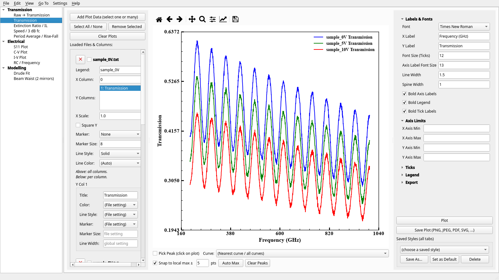

# THz Studio

A desktop app for terahertz (THz) transmission measurements and the device data that goes with them: transmission spectra, extinction ratio, modulation speed, C-V and I-V curves, S11, Drude fits and Gaussian beam optics. It runs on Python with Qt (PySide6) and Matplotlib.



## Tabs

| Group        | Tab                        | What it does                                                                                                                                                                                                                |
| ------------ | -------------------------- | --------------------------------------------------------------------------------------------------------------------------------------------------------------------------------------------------------------------------- |
| Transmission | Raw → Transmission         | Averages reference (air) and sample photocurrent scans of a continuous-wave THz system and computes the amplitude transmission from their RMS upper envelopes. |
|              | Transmission               | Overlays text/CSV spectra, with per-file and per-column styling, peak picking and journal-ready export (PNG, PDF, SVG, EPS with editable fonts).                                                                            |
|              | Extinction Ratio / IL      | Extinction ratio and insertion loss against bias voltage, from the peaks picked on the Transmission tab.                                                                                                                    |
|              | Speed / 3 dB fc            | Fits a sine to each oscilloscope capture, then fits a single-pole low-pass response to Vpp(f) to get the 3 dB cutoff.                                                                                                       |
|              | Period Average / Rise-Fall | Averages whole periods of a square-wave capture and fits logistic edges for 10-90 % rise and fall times.                                                                                                                    |
| Electrical   | S11 Plot                   | \|S11\| in dB from Touchstone (.s1p, .s2p, ...) files.                                                                                                                                                                      |
|              | C-V Plot, I-V Plot         | Excel or CSV sweeps with column detection, unit scaling and several sheets per file.                                                                                                                                        |
|              | RC / Frequency             | τ = RC and f = 1/(2πRC) against voltage, pairing C and R sweeps point by point.                                                                                                                                             |
| Modelling    | Drude Fit                  | Fits the sheet conductance and scattering time of a 2DEG from THz transmission through a dielectric multilayer (transfer matrix) or a Tinkham thin-sheet model.                                                             |
|              | Beam Waist (2 mirrors)     | Gaussian beam waist, Rayleigh range and clipping for two focusing mirrors.                                                                                                                                                  |

## Interface

- Sidebar grouped by task (Ctrl+B switches between sidebar and tab row). View → Show / Hide Tabs hides tabs you do not use.
- Drag files onto the window to load them into the current tab.
- File → Open Recent, and File → Save Session / Open Session (`.thzsession`) to reopen the same files, sheets and plot style later.
- Every graph has the Matplotlib toolbar (zoom, pan, home, save). Edit → Copy Graph to Clipboard (Ctrl+Shift+C) copies it at 200 dpi.
- Saved plot styles apply to all tabs at once (Settings menu and the style box under each tab).
- Light, Dark or System theme and four text sizes (View menu). Graphs stay white so exported figures do not change.
- Panels can be resized by dragging the splitter handles, and the window works from about 880 × 400 px up to full screen.
- Help → Keyboard Shortcuts (F1) lists every shortcut.

## Install

Python 3.10 or newer.

```bash
git clone https://github.com/geofrey89/thz-studio.git
cd thz-studio
python -m venv .venv
source .venv/bin/activate        # Windows: .venv\Scripts\activate
pip install -r requirements.txt
python thz_studio.py
```

## Data formats

| Data | Tabs | Format |
|---|---|---|
| Spectra | Transmission, Raw → Transmission, Drude Fit | Text, DAT or CSV with numeric columns. A header row is optional; `#` comment lines are skipped. |
| C-V, I-V and R sweeps | C-V Plot, I-V Plot, RC / Frequency | `.xls`, `.xlsx` or CSV. X and Y columns are guessed from the header names and can be changed. |
| Oscilloscope captures | Speed / 3 dB fc, Period Average | CSV with a metadata block and a `TIME,<channel>` header row. |
| S-parameters | S11 Plot | Touchstone `.sNp` (RI, MA or DB format). |

## Settings

Saved plot styles are JSON files in `~/.config/thzstudio/styles/` on every system. Window layout, theme, recent files and the last data folder are stored per user with QSettings:

- Linux: `~/.config/thzstudio/thzstudio.conf`
- Windows: registry under `HKEY_CURRENT_USER\Software\thzstudio`
- macOS: `~/Library/Preferences/com.thzstudio.thzstudio.plist`

On GNOME Wayland the app runs through XWayland so the window title bar works normally. Set `QT_QPA_PLATFORM=wayland` before starting to use native Wayland instead.

## Equations and references

### Drude Fit

- Drude sheet conductance of the 2DEG [1]:
  $`G(\omega) = \dfrac{G_0}{1 + i\omega\tau}`$, with $`G_0 = e\,n_s\,\mu`$.
  The app uses the time dependence $`e^{i(\omega t - kz)}`$ of the layer matrices [2]. With this choice the Drude denominator is $`1 + i\omega\tau`$ and an absorbing layer is $`n - i\kappa`$. Texts that use $`e^{-i\omega t}`$ write $`1 - i\omega\tau`$ and $`n + i\kappa`$ instead.
- Layer refractive index from the table: $`n = \sqrt{\varepsilon_r}`$, or $`n`$ entered directly.
- Transfer matrix of layer $`j`$ at normal incidence [2]:

```math
M_j = \begin{pmatrix} \cos\delta_j & i\sin\delta_j/\gamma_j \\ i\gamma_j\sin\delta_j & \cos\delta_j \end{pmatrix}
```

  with $`\delta_j = \dfrac{2\pi}{\lambda} n_j d_j`$ and $`\gamma_j = n_j`$ (the admittance normalized by $`\sqrt{\varepsilon_0\mu_0}`$, which leaves $`t`$ unchanged).
- Whole stack $`M_T = M_1 M_2 \cdots M_N`$ and field transmission [2]:
  $`t = \dfrac{2\gamma_0}{\gamma_0 m_{11} + \gamma_0\gamma_s m_{12} + m_{21} + \gamma_s m_{22}}`$.
- The 2DEG is a conducting sheet between two layers, entered as the matrix

```math
S = \begin{pmatrix} 1 & 0 \\ y & 1 \end{pmatrix}
```

  with $`y = Z_0\,G(\omega)`$ (sheet conductance in units of the free-space admittance $`1/Z_0`$). Depending on the model chosen, the fit uses $`|t|`$ of the stack with the sheet or $`|t_{\text{with sheet}}| / |t_{\text{without sheet}}|`$.
- Thin-sheet (Glover-Tinkham) model for a sheet on a substrate of index $`n`$, normalized to the bare substrate [3, 4]:
  $`t_{\text{norm}} = \dfrac{1 + n}{1 + n + Z_0\,G(\omega)}`$, with $`Z_0 = 376.73\ \Omega`$.
  It assumes a sheet much thinner than the wavelength and no multiple reflections inside the substrate, so the app uses it as a fast envelope model and the transfer-matrix models for the full spectrum.
- Smoothing: Savitzky-Golay filter [5]. Fitting: differential evolution [6] followed by trust-region least squares [7], both from SciPy [8]. The fit parameters are $`\log_{10} G_0`$, $`\log_{10}\tau`$ and one scale ratio per fitted layer value. The 1σ uncertainty of parameter $`i`$ is $`\sigma_i = s\sqrt{\left[(J^{T}J)^{-1}\right]_{ii}}`$, where $`J`$ is the Jacobian at the best fit and $`s^2 = \mathrm{SS}_{\mathrm{res}}/(N - p)`$, so the $`G_0`$ and $`\tau`$ uncertainties are in decades.

### Beam Waist (2 mirrors)

- Far-field divergence [9]: $`2\theta = \dfrac{4\lambda}{\pi\,(2w_0)}`$
- Rayleigh range [2, 9]: $`z_0 = \dfrac{\pi w_0^2}{\lambda}`$
- Beam radius [2, 9]: $`w(z) = w_0\sqrt{1 + (z/z_0)^2}`$
- Wavefront radius [2, 9]: $`R(z) = z\left[1 + (z_0/z)^2\right]`$
- Beam quality [9]: a real beam follows the same formulas with $`\lambda`$ replaced by $`M^2\lambda`$.
- Focusing mirror of focal length $`f`$ (paraxial thin-lens rule) [2]: $`\dfrac{1}{q_2} = \dfrac{1}{q_1} - \dfrac{1}{f}`$, so $`w`$ is unchanged and $`\dfrac{1}{R_2} = \dfrac{1}{R_1} - \dfrac{1}{f}`$.
- Power inside a mirror of diameter $`D`$, from the Gaussian irradiance profile [2]: $`P/P_0 = 1 - \exp\!\left(-\dfrac{2(D/2)^2}{w^2}\right)`$

### Raw → Transmission

- Envelope of each scan: moving RMS of the mean-removed signal over $`n`$ points, with the mean added back: $`E(f) = \bar{y} + \sqrt{\langle (y - \bar{y})^2 \rangle_n}`$. The moving mean of the transmission uses a second window of $`m`$ points. Both windows shrink at the ends of the scan.
- In coherent continuous-wave THz detection the photocurrent is proportional to the THz electric field and oscillates with frequency, so its envelope gives the field amplitude. The ratio of the sample and air-reference envelopes is the amplitude transmission, and the power transmittance is its square [10]:
  $`t(f) = \dfrac{E_{\text{sample}}(f)}{E_{\text{reference}}(f)}`$, $`T(f) = t(f)^2 = \left(\dfrac{I_{\text{ph}}^{\text{sample}}}{I_{\text{ph}}^{\text{reference}}}\right)^2`$.
  The tab plots and saves $`t(f)`$. Tick **Square Y** on the Transmission tab to plot $`T(f)`$. Roggenbuck et al. [10] read the envelopes at the extrema of the interference pattern; the app uses the moving RMS envelope above, which follows the same extrema without picking them one by one.
- When several scans of the same sample are loaded (e.g. `0v_0001`, `0v_0002`), their currents are averaged before the envelope is taken.

### Extinction Ratio / IL

- Extinction ratio: $`\mathrm{ER} = 10\log_{10}\dfrac{T_{\text{on}}}{T_{\text{off}}}`$ for power data, or $`20\log_{10}`$ for amplitude data. $`T_{\text{off}}`$ is the reference curve (0 V by default). The ratio can also be shown as $`T_{\text{off}}/T_{\text{on}}`$ or as a linear ratio.
- Insertion loss: $`\mathrm{IL} = -10\log_{10} T_{\text{on}}`$ (power) or $`-20\log_{10} T_{\text{on}}`$ (amplitude).

### Speed / 3 dB fc and RC / Frequency

- Sine fit to each capture: $`v(t) = A\sin\!\big(2\pi f (t - t_0) + \varphi\big) + c`$, with $`V_{pp} = 2|A|`$. The frequency and phase start from the FFT peak.
- Single-pole low-pass response: $`V_{pp}(f) = \dfrac{V_0}{\sqrt{1 + (f/f_c)^2}}`$, fitted in dB. The measured cutoff is where $`20\log_{10}(V_{pp}/V_0) = -3`$ dB, interpolated in $`\log f`$.
- RC tab: $`\tau = RC`$ and $`f = \dfrac{1}{2\pi RC}`$.

### Period Average / Rise-Fall

- Edge model (4-parameter logistic): $`y(t) = y_0 + \dfrac{A}{1 + e^{-k(t - t_0)}}`$.
- 10 % to 90 % transition time: $`t_{90} - t_{10} = \dfrac{2\ln 9}{k}`$.
- The period comes from an FFT peak refined by parabolic interpolation, then by a line fit to the times of rising mid-level crossings.

### S11 Plot

- $`|S_{11}|_{\text{dB}} = 20\log_{10}|S_{11}|`$. RI, MA and DB records are read as defined in the Touchstone specification [11].

### References

1. N. W. Ashcroft and N. D. Mermin, *Solid State Physics* (Saunders College, Philadelphia, 1976).
2. F. L. Pedrotti, L. M. Pedrotti and L. S. Pedrotti, *Introduction to Optics*, 3rd ed. (Pearson Prentice Hall, Upper Saddle River, NJ, 2007).
3. R. E. Glover III and M. Tinkham, "Conductivity of superconducting films for photon energies between 0.3 and 40 kT<sub>c</sub>," *Phys. Rev.* **108**, 243 (1957).
4. M. Tinkham, "Energy gap interpretation of experiments on infrared transmission through superconducting films," *Phys. Rev.* **104**, 845 (1956).
5. A. Savitzky and M. J. E. Golay, "Smoothing and differentiation of data by simplified least squares procedures," *Anal. Chem.* **36**, 1627 (1964).
6. R. Storn and K. Price, "Differential evolution: a simple and efficient heuristic for global optimization over continuous spaces," *J. Global Optim.* **11**, 341 (1997).
7. M. A. Branch, T. F. Coleman and Y. Li, "A subspace, interior, and conjugate gradient method for large-scale bound-constrained minimization problems," *SIAM J. Sci. Comput.* **21**, 1 (1999).
8. P. Virtanen et al., "SciPy 1.0: fundamental algorithms for scientific computing in Python," *Nat. Methods* **17**, 261 (2020).
9. S. O. Kasap, *Optoelectronics and Photonics: Principles and Practices*, 2nd ed. (Pearson, Harlow, 2013).
10. A. Roggenbuck, H. Schmitz, A. Deninger, I. Cámara Mayorga, J. Hemberger, R. Güsten and M. Grüninger, "Coherent broadband continuous-wave terahertz spectroscopy on solid-state samples," *New J. Phys.* **12**, 043017 (2010).
11. IBIS Open Forum, *Touchstone File Format Specification*, version 2.0 (2009).

## Third-party software

THz Studio imports the packages below at run time and does not include or modify their code. Each keeps its own license.

| Package | License |
|---|---|
| PySide6 / Qt for Python | LGPL-3.0 (or GPL) |
| Matplotlib | Matplotlib License (BSD-style) |
| NumPy, SciPy, pandas, xlrd | BSD-3-Clause |
| openpyxl | MIT |

## License

No license has been granted. All rights reserved. If you would like to use or adapt this code, please open an issue.
